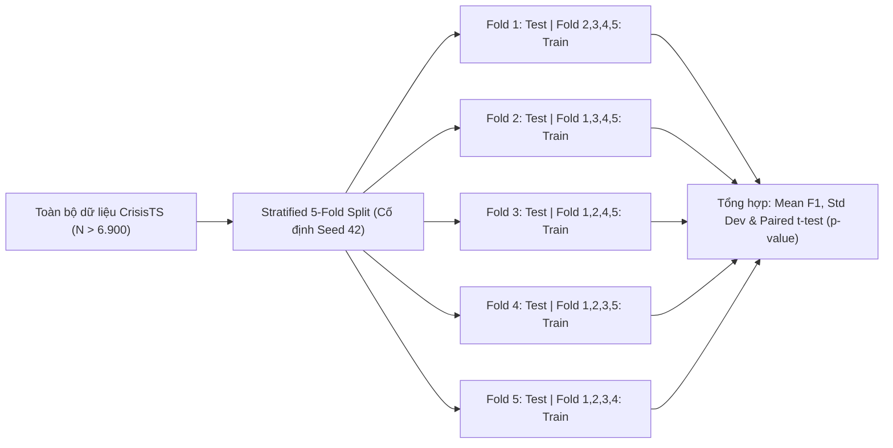

# ĐỀ CƯƠNG NGHIÊN CỨU KHOA HỌC (RESEARCH PROPOSAL)
**Học phần:** SC203 – Phương pháp Nghiên cứu Khoa học (Scientific Methods)  
**Đơn vị:** Trường Đại học Khoa học Tự nhiên – ĐHQG TP.HCM (VNUHCM-US)  
**Tên đề tài:** Phân loại mức độ khẩn cấp trong thiên tai bằng mô hình học đa phương thức kết hợp văn bản mạng xã hội và chuỗi thời gian khí tượng (Dựa trên benchmark quốc tế CrisisTS – ACL 2025)  
**Ngày lập đề cương:** 07/11/2026  

---

## 1. Bối cảnh & Lý do thay đổi đề tài (Context & Justification)

Theo định hướng và phản biện trực tiếp từ giảng viên học phần SC203:
1. **Khắc phục lời nguyền số chiều (Curse of Dimensionality) của dữ liệu nhỏ:** Đề tài ngập lụt TP.HCM trước đây chỉ có 147 mẫu có nhãn trên nhiều biến hành chính, dẫn đến tình trạng thiếu ràng buộc nghiêm trọng (under-constrained), phương sai mô hình quá lớn và phụ thuộc vào giá trị ngoại lai dị biệt. Học máy thống kê (Statistical Learning) đòi hỏi tập dữ liệu quy mô lớn ($>10.000$ mẫu) để đảm bảo tính tổng quát.
2. **Tiêu chuẩn học thuật đỉnh cao (Academic Benchmark):** Thay vì các tập dữ liệu tự thu thập thô thiếu đối chứng, nhóm chuyển dịch sang bài toán chuẩn được công bố tại hội nghị ngôn ngữ học điện toán hàng đầu thế giới: **ACL 2025 (Long Paper)**:  
   > *"CrisisTS: Coupling Social Media Textual Data and Meteorological Time Series for Urgency Classification"* (Meunier et al., ACL 2025).
3. **Phát huy thế mạnh ngành Công nghệ thông tin:** Chuyển từ việc phân tích thủy văn/địa chất chuyên sâu (vốn đòi hỏi chuyên gia chuyên ngành) sang bài toán cốt lõi của Khoa học máy tính: **Xử lý ngôn ngữ tự nhiên (NLP) kết hợp Phân tích chuỗi thời gian (Time Series) và Học đa phương thức (Multimodal Fusion)**.

---

## 2. Quan sát khoa học (Observation)

Trong các sự kiện thiên tai cực đoan (bão lốc, lũ lụt, cháy rừng, sóng thần):
* **Phương thức văn bản (Textual modality):** Mạng xã hội (Twitter/X) cung cấp luồng thông tin phản ứng tức thời từ người dân tại hiện trường (lời kêu cứu, thông báo vị trí, cảnh báo nguy hiểm). Tuy nhiên, văn bản mạng xã hội chứa nhiều nhiễu, cảm xúc chủ quan, cường điệu hoặc tin giả, thiếu đi căn cứ vật lý khách quan.
* **Phương thức khí tượng (Meteorological modality):** Dữ liệu chuỗi thời gian đo đạc từ vệ tinh và trạm thời tiết (lượng mưa tích lũy, tốc độ gió, áp suất khí quyển, nhiệt độ bề mặt) cung cấp bức tranh vật lý khách quan và liên tục. Tuy nhiên, các cảm biến khí tượng đơn thuần không thể ghi nhận được tác động nhân văn thực tế (thiệt hại người, sập cầu cống, khu dân cư bị cô lập cần cứu nạn khẩn cấp).
* **Khoảng trống nghiên cứu:** Các mô hình cứu nạn truyền thống thường chỉ xử lý đơn phương thức (Text-only hoặc TimeSeries-only). Việc kết hợp đồng thời phản ánh hiện trường (Text) và bối cảnh động lực học khí quyển (Meteorology) hứa hẹn sẽ lọc bỏ tin nhiễu và định vị chính xác các khu vực khẩn cấp ưu tiên điều phối lực lượng cứu hộ.

---

## 3. Giả thuyết nghiên cứu (Hypotheses)

### 3.1. Giả thuyết chính ($H_1$)
> *Mô hình học đa phương thức (Multimodal Fusion) kết hợp đặc trưng biểu diễn văn bản ngữ cảnh (từ RoBERTa/DeBERTa) và chuỗi thời gian khí tượng 11 kênh đo (qua BiLSTM / 1D-CNN) sẽ đạt hiệu quả phân loại mức độ khẩn cấp (Urgency Classification) vượt trội có ý nghĩa thống kê ($p < 0,05$ qua kiểm định t-test cặp trên $K$-Fold) với mức tăng tối thiểu $+3,0\%$ Macro-F1 so với mô hình tốt nhất chỉ dùng đơn phương thức văn bản (Text-only).*

### 3.2. Giả thuyết vô hiệu ($H_0$)
> *Việc bổ sung chuỗi thời gian khí tượng vào mô hình ngôn ngữ không đem lại sự cải thiện vượt trội có ý nghĩa thống kê về Macro-F1 ($\Delta\text{F1} \le 0,5\%$ hoặc $p \ge 0,05$) trong bài toán phân loại khẩn cấp.*

---

## 4. Xác định các biến số nghiên cứu (Variables Framework)

| Phân loại | Tên biến | Thang đo / Kiểu dữ liệu | Định nghĩa thực nghiệm |
|---|---|---|---|
| **Biến độc lập 1** | *Văn bản hiện trường ($X_{\text{text}}$)* | Văn bản chuỗi (Tokens) | Bài đăng mạng xã hội đã chuẩn hóa (loại bỏ URL, emoji, tiền xử lý ký tự) |
| **Biến độc lập 2** | *Chuỗi khí tượng ($X_{\text{ts}}$)* | Ma trận số $W \times C$ ($5 \times 11$) | Chuỗi thời gian chuẩn hóa 11 chỉ số vật lý (lượng mưa, gió, nhiệt, áp suất, độ ẩm...) trong cửa sổ 5 ngày quanh sự kiện |
| **Biến độc lập 3** | *Chiến lược dung hợp ($M_{\text{fusion}}$)* | Biến phân loại danh mục | Đơn phương thức (Text-only, TS-only), Late Fusion (Concatenation), Cross-Attention Fusion |
| **Biến phụ thuộc** | *Mức độ khẩn cấp ($Y_{\text{urgent}}$)* | Nhị phân (`Urgent` vs `Non-urgent`) | Nhãn chuẩn hóa mức độ cần cứu hộ/ứng phó khẩn cấp của bài đăng |
| **Biến phụ thuộc phụ** | *Phân loại nhân đạo ($Y_{\text{humanitarian}}$)* | Đa lớp (6 nhãn) | `injured_or_dead_people`, `infrastructure`, `rescue_volunteering`, v.v. |
| **Biến kiểm soát** | *Kỹ thuật chia Fold* | Cố định ($K = 5$) | Phân tầng theo phân phối nhãn (Stratified K-Fold) trên toàn bộ dữ liệu |
| **Biến kiểm soát** | *Siêu tham số huấn luyện* | Hằng số thực nghiệm | Optimizer AdamW, Learning rate $2\times 10^{-5}$ cho text, Batch size = 16, Cố định `random_state = 42` |

---

## 5. Dữ liệu thực nghiệm (Dataset: CrisisTS Benchmark)

Dữ liệu được khai thác chính thức từ kho lưu trữ của nhóm nghiên cứu tại Hugging Face: [`Unknees/CrisisTS`](https://huggingface.co/datasets/Unknees/CrisisTS):

* **Quy mô tập dữ liệu tiếng Anh (`CrisisTS_Eng.csv`):** Hơn $6.900$ bài đăng hoàn chỉnh đã được căn chỉnh không thời gian chính xác với chuỗi khí tượng tương ứng.
* **Các loại hình thiên tai đại diện:** Bão nhiệt đới (Cyclones, Hurricanes), Lũ lụt (Floods), Cháy rừng (Wildfires), Động đất (Earthquakes).
* **Ma trận chuỗi khí tượng:** Kích thước cửa sổ 5 ngày $\times$ 11 biến khí tượng:
  1. Lượng mưa tích lũy ($mm$)
  2. Tốc độ gió tối đa ($m/s$) & Hướng gió
  3. Áp suất khí quyển mực nước biển ($hPa$)
  4. Nhiệt độ tối đa, tối thiểu, trung bình ($^\circ C$)
  5. Độ ẩm tương đối (%)
  6. Bức xạ mặt trời mặt đất
  7. Chỉ số bốc thoát hơi nước

---

## 6. Thiết kế phương pháp luận & Kiến trúc mô hình (Methodology)

### 6.1. Quy trình kiểm định K-Fold chuẩn (Thực hiện đúng chỉ đạo của Giảng viên)
Thầy đã giảng dạy rất kỹ về kỹ thuật xoay vòng Fold để kiểm tra tính ổn định:

### 6.2. Không gian mô hình đối chứng (Benchmark Suite)

1. **Baseline 0 (Dummy Comparator):**
   * *Stratified Random Baseline* & *Majority Class Classifier* (đáp ứng nguyên tắc khoa học: luôn có mốc tối thiểu).
2. **Baseline 1 (Time Series Only):**
   * Mô hình `BiLSTM` hoặc `1D-CNN` 2 tầng tiếp nhận ma trận $(5, 11)$ $\to$ Fully Connected Layer $\to$ Phân loại.
3. **Baseline 2 (Text Only):**
   * Mô hình ngôn ngữ tiền huấn luyện SOTA: **`RoBERTa-base`** (hoặc `DeBERTa-v3-base`) tinh chỉnh (fine-tuning) trên trường `Text`.
4. **Mô hình Đề xuất 1 (Early/Late Multimodal Fusion):**
   * Trích xuất vector ngữ cảnh `[CLS]` từ RoBERTa ($d_1 = 768$) và vector đại diện chuỗi khí tượng từ BiLSTM ($d_2 = 128$).
   * Ghép nối (Concatenation) $z = [h_{\text{text}}; h_{\text{ts}}] \in \mathbb{R}^{896}$ qua mạng nơ-ron đa tầng (MLP) có Dropout để dự đoán nhãn.
5. **Mô hình Đề xuất 2 (Cross-Attention Multimodal Fusion):**
   * Dùng cơ chế Cross-Attention để chuỗi khí tượng đóng vai trò *Query/Key* điều biến trọng số các từ khóa trong văn bản, giúp mô hình tập trung vào các câu chữ miêu tả tương thích với dữ liệu đo đạc thực tế.

---

## 7. Tiêu chí đánh giá & Kiểm định thống kê (Evaluation Metrics)

* **Chỉ số đánh giá chính:** **Macro-F1 Score** (do nhãn trong thiên tai thường bị mất cân bằng, Urgent chiếm thiểu số).
* **Chỉ số đánh giá phụ:** Balanced Accuracy, Precision, Recall, và diện tích dưới đường cong ROC-AUC.
* **Kiểm định giả thuyết khoa học:**
  * Thực hiện **Paired t-test** (kiểm định Student theo cặp) và **Wilcoxon Signed-Rank Test** trên 5 giá trị Macro-F1 của 5 Folds giữa mô hình Đa phương thức và mô hình Text-only.
  * Nếu $p\text{-value} < 0,05$, nhóm chính thức bác bỏ giả thuyết vô hiệu $H_0$ và chấp nhận giả thuyết nghiên cứu $H_1$.

---

## 8. Kế hoạch thực hiện & Phân công nhiệm vụ (Timeline)

| Giai đoạn | Nội dung công việc | Đầu ra (Deliverables) | Dự kiến hoàn thành |
|:---:|---|---|:---:|
| **Tuần 1** | Tải dataset từ Hugging Face, tiền xử lý dữ liệu, thiết lập môi trường PyTorch + Transformers | `eda_crisists.ipynb`, script chia 5-Fold | Ngày 10/11/2026 |
| **Tuần 2** | Huấn luyện các mô hình đơn phương thức (Time Series BiLSTM, Text RoBERTa) làm baseline chuẩn | `baseline_metrics.csv`, model checkpoints | Ngày 17/11/2026 |
| **Tuần 3** | Xây dựng kiến trúc Multimodal Fusion (Late Fusion & Cross-Attention), chạy 5-Fold toàn diện | `multimodal_metrics.csv`, so sánh độ biến động qua Folds | Ngày 24/11/2026 |
| **Tuần 4** | Thực hiện kiểm định ý nghĩa thống kê ($p$-value), vẽ biểu đồ ma trận nhầm lẫn và trực quan hóa trọng số chú ý | Báo cáo hoàn chỉnh, biểu đồ t-test, biểu đồ độ hội tụ | Ngày 01/12/2026 |
| **Tuần 5** | Hoàn thiện Slide thuyết trình và bài báo cáo khoa học theo chuẩn format hội nghị khoa học | Slide nghiệm thu, Manuscript bài báo | Ngày 08/12/2026 |

---

## 9. Ý nghĩa đóng góp & Mục tiêu hội nghị

* **Tính thời sự & thực tiễn:** Khắc phục nhược điểm tin giả và tin nhiễu trên mạng xã hội bằng căn cứ đo đạc thời tiết khách quan, cung cấp công cụ tự động hỗ trợ điều phối cứu trợ khẩn cấp.
* **Cơ hội công bố khoa học:** Đề tài bám sát cấu trúc của bài báo ACL 2025. Kết quả thực nghiệm nếu hoàn thành đúng tiến độ và phương pháp luận sẽ đủ điều kiện gửi tham gia **Hội nghị Khoa học Cơ bản Toàn quốc** do Trường ĐH Khoa học Tự nhiên đăng cai tổ chức vào năm tới như định hướng của Thầy.
